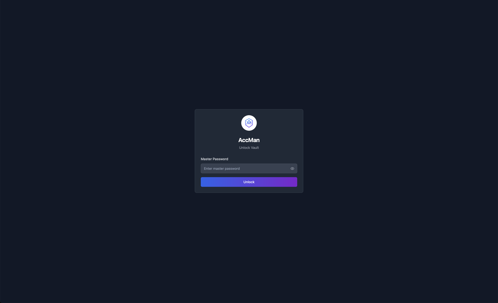
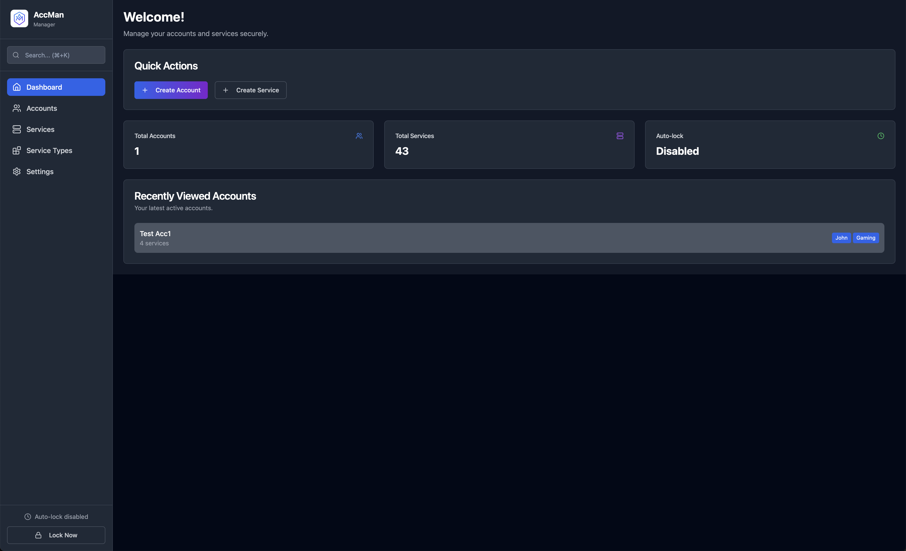
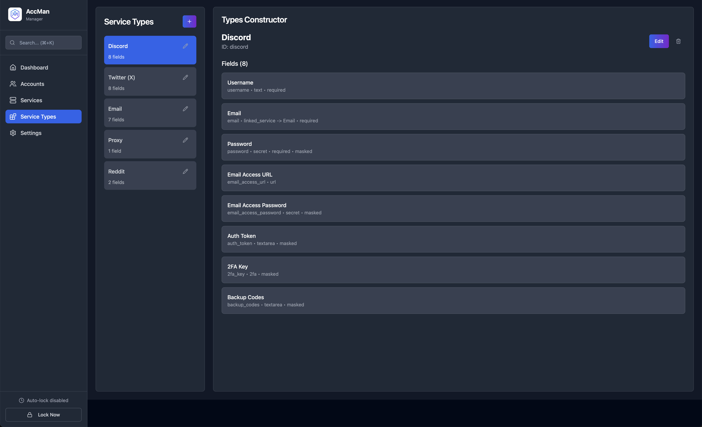
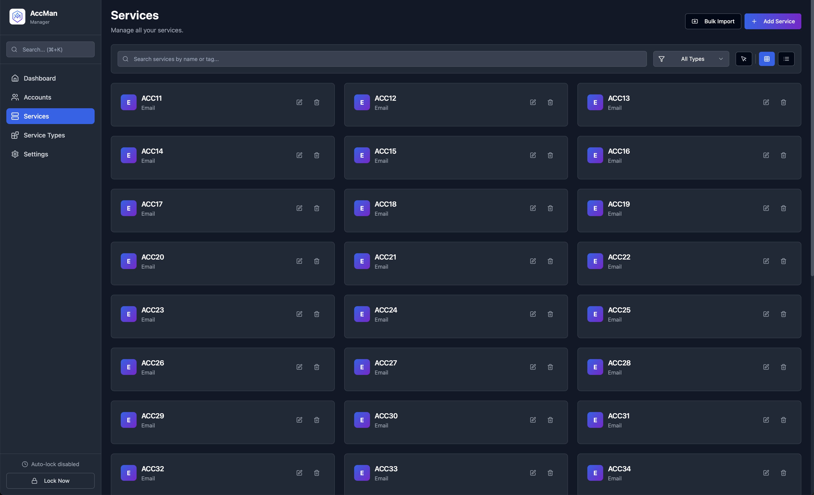
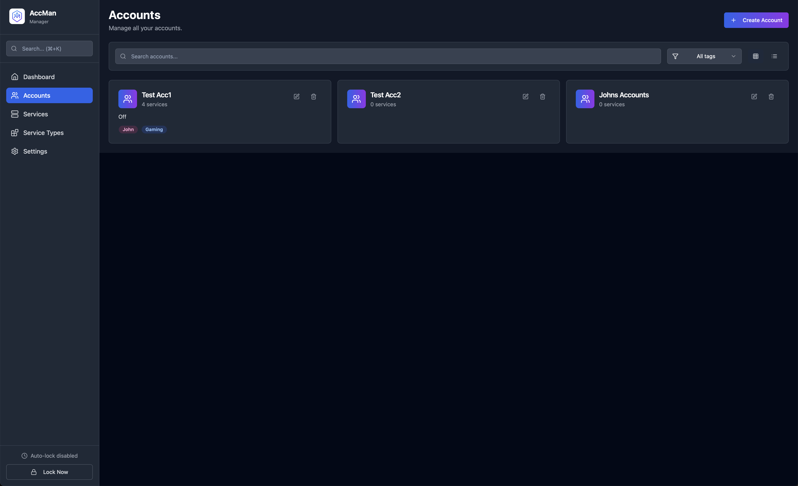

# 🔐 AccMan - Account Manager

<div align="center" markdown="1">
  
  
  **Secure and intuitive desktop application for managing your accounts and services.**
  
  [](https://github.com/romirom11/AccMan/actions/workflows/release.yml)
  
  [](https://github.com/romirom11/AccMan/releases)
</div>

## About

AccMan is a secure desktop application for comprehensive account management. Whether you're managing multiple accounts across different services, organizing personal credentials, or handling business accounts, AccMan provides a flexible and secure solution to store, organize, and quickly access all your account data in one encrypted vault.

## 📸 Screenshots

<div align="center">
  










</div>

## ✨ Features

- 🔒 **Secure Local Storage** - One encrypted vault file on your device (AES-256-GCM, key derived with scrypt). Your vault data stays local: the network is used only when you open an inbox in the email viewer (IMAP) and when AccMan checks GitHub for updates.
- 🛟 **Crash-safe saves and automatic backups** - Every save is written atomically, and encrypted backups of the vault are taken automatically (the newest 15 are kept). Restore one from the lock screen or from Settings.
- 💾 **Encrypted export with its own password** - Export the whole vault to a file protected by a password you choose; the file is read back and verified after writing. Import merges or replaces data and shows a summary.
- 🎯 **Multi-Account Organization** - Manage dozens of accounts per service efficiently, with bulk creation and bulk delete
- 🏷️ **Service Templates** - Create reusable service types with your own fields (text, secret, multi-line, URL, 2FA, link to another service)
- 🔑 **Live 2FA codes** - TOTP codes are shown live with a countdown and copied with one click (base32 secrets and `otpauth://` URIs)
- 📋 **Clipboard auto-clear** - Copied passwords, keys and codes are cleared from the clipboard after a configurable time if it still holds them; anything AccMan copied is also cleared when the vault locks or the app closes (clipboard history tools such as Win+V keep their own copies)
- 🎲 **Password generator** - Generate strong passwords for services and for the master password, with a strength hint
- ⌨️ **Command palette** - `Ctrl/Cmd+K` searches accounts and services and runs actions; `Ctrl/Cmd+L` locks the vault
- 📌 **Pinned and recent items** - Pin favourite accounts and services; the dashboard shows pinned and recently updated items
- 🩺 **Vault health** - Finds reused values (passwords, emails, proxies), weak passwords, invalid 2FA secrets, missing required fields, services without an account and empty accounts
- 📧 **Email inbox and verification codes** - Read recent emails of an IMAP mailbox over implicit TLS (IMAPS, usually port 993; built-in presets for popular providers, or your own IMAP host) and wait for a new verification code, which is copied automatically
- 📥 **Bulk Import** - Import many services at once from text (one line per service, custom separator)
- 🔗 **Account Linking** - Link multiple services to single accounts
- 🌍 **Multi-language** - Available in English and Ukrainian
- 📱 **Cross-Platform** - Works on Windows, macOS, and Linux; only one instance runs at a time

## 🚀 Quick Start

### Download

Download the latest version from the [Releases](https://github.com/romirom11/AccMan/releases) page.

### Installation

#### Windows
1. Download the `.msi` installer
2. Run the installer and follow the setup wizard
3. Launch AccMan from the Start Menu

#### macOS
1. Download the `.dmg` or `.app.tar.gz` file.
2. If you downloaded the `.dmg`, open it and drag `AccMan.app` to your Applications folder.
3. If you downloaded `.app.tar.gz`, unpack it.
4. Before launching the app for the first time, you may need to remove the quarantine attribute set by macOS. Open your terminal and run:
   ```bash
   xattr -d com.apple.quarantine /path/to/your/AccMan.app
   ```
   *Tip: You can drag the `AccMan.app` file into the terminal window to automatically insert the correct path.*
5. Launch AccMan. You may need to grant it permission to run in `System Settings > Privacy & Security`.

#### Linux
1. Download the `.AppImage` file
2. Make it executable: `chmod +x AccMan.AppImage`
3. Run: `./AccMan.AppImage`

## 🛠️ Development

### Prerequisites

- [Node.js](https://nodejs.org/) (v20 or later to build; v24 or later to run the frontend tests)
- [pnpm](https://pnpm.io/) (v9 or later)
- [Rust](https://www.rust-lang.org/) (latest stable)

### Setup

1. **Clone the repository**
   ```bash
   git clone https://github.com/romirom11/AccMan.git
   cd AccMan
   ```

2. **Install dependencies**
   ```bash
   # Install root dependencies (Tauri CLI)
   pnpm install
   
   # Install frontend dependencies
   pnpm --dir src install
   ```

3. **Start development server**
   ```bash
   pnpm tauri dev
   ```

### Build from Source

If you prefer to build the application yourself, follow these steps:

1.  **Clone and set up the project** as described in the [Setup](#setup) section.
2.  **Build the application** with a single command:

    ```bash
    pnpm tauri build
    ```

This will create a production-ready executable file in the `src-tauri/target/release/` directory.

### Tests and Lint

```bash
# Rust unit tests (crypto, storage, vault operations, email parsing)
cd src-tauri && cargo test

# Frontend unit tests (pure logic in src/lib, run with node:test; needs Node.js 24+)
pnpm --dir src test

# Type check and lint the frontend
pnpm --dir src exec tsc --noEmit
pnpm --dir src lint
```

### Vault file and upgrades

The vault is stored as `vault.json` in the app's local data folder (identifier `com.romirom11.accman`), with automatic backups in a `backups/` folder next to it. The current file format is v2 (AES-256-GCM, scrypt with logN=17, r=8, p=1, parameters stored in the file). Vaults created by older versions (format v1) still open: after the first successful unlock AccMan backs up the old file and re-encrypts the vault in the v2 format automatically.

## 🏗️ Project Structure

```
AccMan/
├── src/                    # Frontend React application
│   ├── components/         # React components
│   ├── pages/             # Application pages
│   ├── hooks/             # Custom React hooks
│   ├── stores/            # State management (Zustand)
│   ├── lib/               # Pure helpers (TOTP, passwords, search, vault health, ...)
│   ├── types/             # TypeScript types mirroring the Rust models
│   ├── tests/             # node:test unit tests for src/lib
│   ├── locales/           # Internationalization files
│   └── api/               # API layer (Tauri commands, error handling)
├── src-tauri/             # Tauri backend (Rust)
│   ├── src/               # Rust source code
│   ├── icons/             # Application icons
│   └── Cargo.toml         # Rust dependencies
└── .github/workflows/     # CI/CD workflows
```

## 🔧 Tech Stack

- **Frontend**: React, TypeScript, Tailwind CSS, Vite
- **Backend**: Rust, Tauri
- **State Management**: Zustand
- **Styling**: Tailwind CSS, shadcn/ui components
- **Internationalization**: i18next
- **Build Tool**: Vite
- **Package Manager**: pnpm

## 🚧 Roadmap

### Upcoming Features

- 📊 **Account Analytics** - Track usage patterns across your accounts
- 🔄 **More Bulk Operations** - Mass edit and tagging of accounts and services
- 📋 **Account Templates** - Quick setup for common account types
- 🏷️ **Advanced Tagging** - Better organization with hierarchical tags
- 📱 **Mobile Companion** - View-only mobile app for quick access
- 🎨 **Themes** - Dark/light mode and custom themes

### In Development

- 🔑 Enhanced 2FA management with QR code scanning
- 🎛️ Advanced field customization with templates
- 📥 Improved import from popular password managers

Want to suggest a feature? [Open an issue](https://github.com/romirom11/AccMan/issues/new) or start a [discussion](https://github.com/romirom11/AccMan/discussions)!

## 🌍 Internationalization

AccMan supports multiple languages:
- 🇺🇸 English
- 🇺🇦 Ukrainian

To add a new language:
1. Create a new folder in `src/locales/`
2. Add translation files
3. Update the i18n configuration

## 🤝 Contributing

We welcome contributions! Please see our [Contributing Guidelines](docs/contributing.md) for details.

1. Fork the repository
2. Create your feature branch (`git checkout -b feature/amazing-feature`)
3. Commit your changes (`git commit -m 'Add some amazing feature'`)
4. Push to the branch (`git push origin feature/amazing-feature`)
5. Open a Pull Request

## 📝 License

This project is licensed under the MIT License.

## 🙏 Acknowledgments

- [Tauri](https://tauri.app/) - For the amazing framework
- [React](https://reactjs.org/) - For the UI library
- [Tailwind CSS](https://tailwindcss.com/) - For the styling framework
- [shadcn/ui](https://ui.shadcn.com/) - For the beautiful components

## 📞 Support

If you have any questions or need help:
- 🐛 [Report a bug](https://github.com/romirom11/AccMan/issues/new)
- 💡 [Request a feature](https://github.com/romirom11/AccMan/issues/new)
- 💬 [Start a discussion](https://github.com/romirom11/AccMan/discussions)

---

<div align="center">
  Made with ❤️ by romirom11
</div>